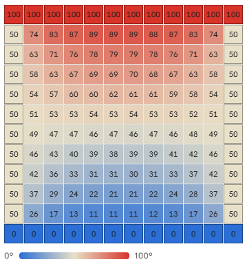

# Simulação de Propagação de Calor 2D (Stencil)

**Disciplina:** Arquitetura de Computadores II  
**Integrantes:** Guilherme Lopes Leão, João Vitor de Melo, Pablo Ribeiro, Gabriel Pereira

Simulação de propagação de calor em uma placa 2D usando um stencil de 4 vizinhos, implementada em C na versão sequencial.

## Compilação

```bash
gcc -O3 -Wall -Wextra main.c -o calor_seq
```

## Execução

Formato: `./calor_seq <N> <T> [semente]`

| Parâmetro | Significado                                                                                                           | Exemplo                     |
| --------- | --------------------------------------------------------------------------------------------------------------------- | --------------------------- |
| `N`       | Tamanho da matriz: a grade tem N × N células (incluindo as bordas).                                                   | `1000` → matriz 1000 × 1000 |
| `T`       | Número de iterações (passos de tempo) da simulação. Em cada passo, toda célula interna recebe a média dos 4 vizinhos. | `500` → 500 passos          |
| `semente` | Opcional. Semente do gerador aleatório; a mesma semente reproduz a mesma matriz inicial e a mesma soma final. Se omitida, usa o relógio. | `42`                        |

```bash
./calor_seq 1000 500 42
./calor_seq 2000 1000 42
./calor_seq 4000 2000 42
```

A saída mostra os parâmetros usados (incluindo a semente sorteada), o tempo da simulação em segundos e a soma final da matriz.

## O problema

Uma placa metálica quadrada é discretizada em uma malha de N × N células. Cada célula guarda a temperatura daquela região da placa. As bordas ficam em contato com fontes de temperatura constante, e o interior começa com valores arbitrários.

Com o passar do tempo, o calor flui das regiões mais quentes para as mais frias, até a placa atingir o regime estacionário, em que a temperatura de cada ponto deixa de variar.



*Figura 1: Evolução da temperatura na placa. As bordas permanecem fixas, e o interior se suaviza a cada iteração até estabilizar.*

### Condições de contorno

| Borda    | Temperatura |
| -------- | ----------- |
| Superior | 100,0       |
| Inferior | 0,0         |
| Esquerda | 50,0        |
| Direita  | 50,0        |

Nos cantos prevalecem as bordas superior e inferior: os cantos de cima valem 100,0 e os de baixo, 0,0.

### Dados de entrada

As células internas recebem valores inteiros pseudoaleatórios entre 0 e 100 (`rand() % 101`). A semente do gerador pode ser passada como terceiro argumento para reproduzir uma execução; sem ela, é obtida do relógio (`time(NULL)`) e cada execução começa com uma matriz inicial diferente. A semente usada é impressa na saída.

Os resultados registrados da versão sequencial estão em [`resultados/sequencial.csv`](resultados/sequencial.csv).

## O modelo: stencil de 4 vizinhos

A cada iteração, a nova temperatura de uma célula interna é a média aritmética dos seus quatro vizinhos ortogonais na iteração anterior:

$$T^{(t+1)}_{i,j} = \frac{T^{(t)}_{i-1,j} + T^{(t)}_{i+1,j} + T^{(t)}_{i,j-1} + T^{(t)}_{i,j+1}}{4}$$

```
            (i-1, j)
               │
 (i, j-1) ── (i, j) ── (i, j+1)
               │
            (i+1, j)
```

Esse padrão de acesso, em que cada ponto é atualizado a partir de uma vizinhança fixa, é chamado de **stencil**. Do ponto de vista numérico, o método corresponde à iteração de Jacobi para a equação de Laplace em uma malha discreta.

## Estratégia de implementação

- **Representação da matriz:** cada matriz é um vetor contíguo de N × N valores `double`. A função `indice(i, j, n)` converte (linha, coluna) na posição `i * n + j`, o que mantém os dados sequenciais na memória.
- **Duas matrizes (`atual` e `nova`):** a iteração t + 1 depende inteiramente dos valores da iteração t. Se o resultado fosse escrito sobre a própria matriz, uma célula poderia usar um vizinho já atualizado, e o resultado passaria a depender da ordem do laço. Por isso, a leitura é feita em `atual` e a escrita em `nova`.
- **Troca de ponteiros:** ao fim de cada iteração, a função `trocar_matrizes` troca os ponteiros de `atual` e `nova`, sem copiar dados.
- **Bordas fixas:** `gerar_matriz` é chamada nas duas matrizes com a mesma semente, então ambas começam iguais e com as bordas preenchidas. Como o laço de `passo_simulacao` percorre apenas o interior (1 a N-2), as bordas nunca são alteradas.
- **Medição de tempo:** o tempo é medido com `clock_gettime(CLOCK_MONOTONIC)` e cobre apenas o laço de iterações. A geração dos dados, a soma final e a impressão ficam fora da medição.
- **Verificação:** ao final, o programa imprime a soma de todas as células. A mesma matriz inicial sempre produz a mesma soma. Como a semente muda a cada execução, a soma também varia entre execuções.
